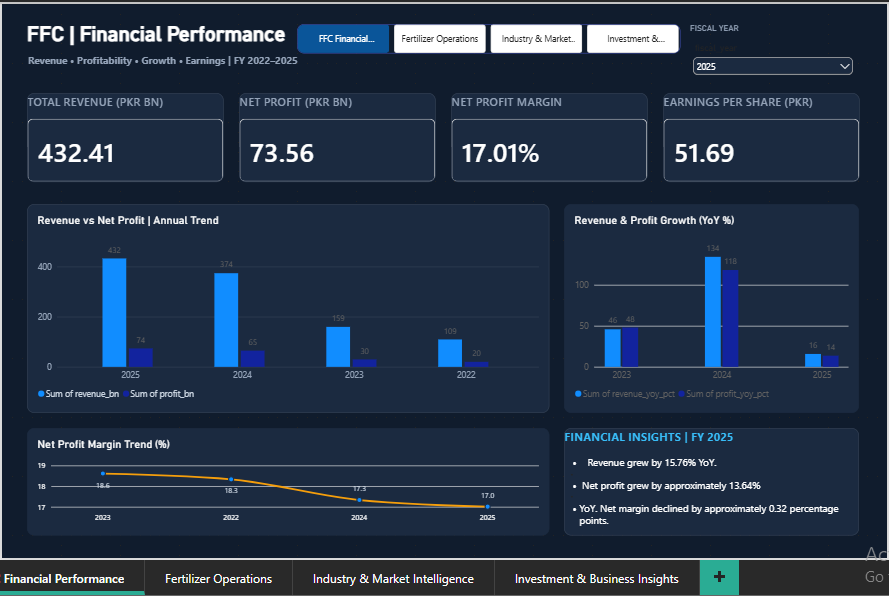
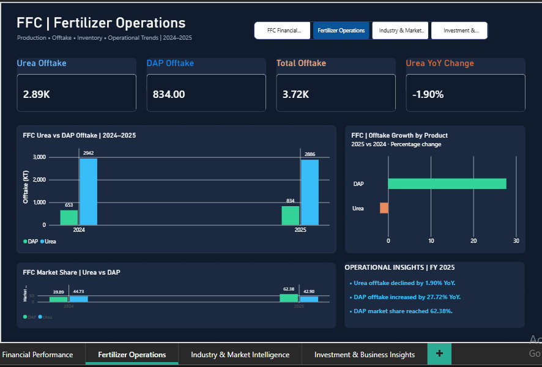
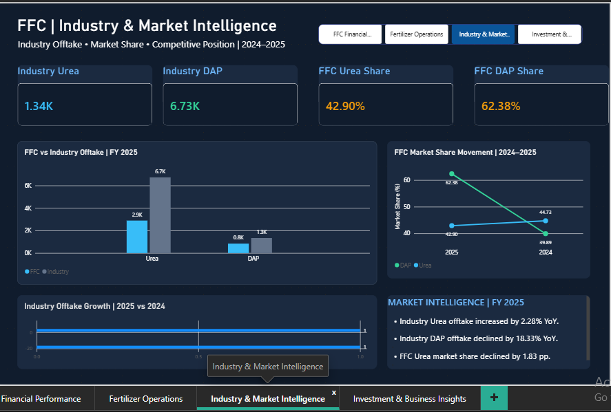
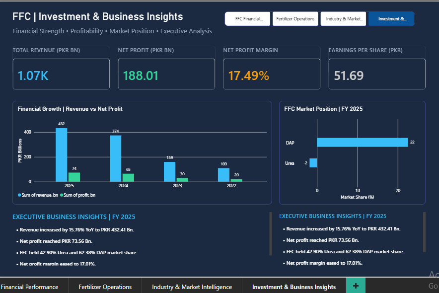

# FFC Intelligence | Financial & Operational Analytics

### End-to-End Business Intelligence Project
**Python • PostgreSQL • SQL • Power BI • Data Analytics**

An end-to-end analytics solution examining Fauji Fertilizer Company (FFC)'s financial performance, fertilizer operations, and competitive market position through data preparation, SQL analytics, and interactive Power BI dashboards.

## Project Overview
FFC Intelligence transforms publicly reported financial and fertilizer industry data into business insights. It analyzes revenue, net profit, margins, earnings per share, Urea and DAP offtake, industry trends, and market share.

## Technology Stack
| Technology | Purpose |
|---|---|
| Python | Data cleaning and ETL |
| PostgreSQL | Database storage |
| SQL | Analytical queries and views |
| Power BI | Interactive dashboards |
| DAX | KPIs and business measures |
| Git & GitHub | Version control and documentation |

## Data Pipeline
```text
Public Financial & Industry Data
             |
             v
      Raw CSV Datasets
             |
             v
      Python Data Cleaning
             |
             v
       Cleaned CSV Files
             |
             v
       PostgreSQL Database
             |
             v
       SQL Analytical Views
             |
             v
       Power BI + DAX
             |
             v
   Four Interactive Dashboards
```

## Dashboard 01 — Financial Performance


Tracks revenue, net profit, net profit margin, EPS, and year-over-year financial growth.

## Dashboard 02 — Fertilizer Operations


Analyzes FFC Urea and DAP offtake, operational growth, and product-level performance.

## Dashboard 03 — Industry & Market Intelligence


Compares FFC and industry fertilizer offtake and tracks market share movements.

## Dashboard 04 — Investment & Business Insights


Combines financial strength, profitability, market position, and executive business insights.

## Key Business Findings — FY 2025

| KPI | Value |
|---|---:|
| Revenue | PKR 432.41 Billion |
| Net Profit | PKR 73.56 Billion |
| Net Profit Margin | 17.01% |
| EPS | PKR 51.69 |
| FFC Urea Offtake | 2,886 KT |
| FFC DAP Offtake | 834 KT |
| Urea Market Share | 42.90% |
| DAP Market Share | 62.38% |

### Additional Insights
- Revenue grew approximately 15.76% year over year.
- Net profit grew approximately 13.64% year over year.
- FFC Urea offtake declined approximately 1.90% year over year.
- FFC DAP offtake increased approximately 27.72% year over year.
- FFC DAP market share increased by approximately 22.49 percentage points.

**Comparability note:** Merger-related changes affect historical comparisons. Reported growth should not automatically be interpreted as organic growth. Industry offtake totals already include FFC volumes.

## Repository Structure
```text
FFC-Intelligence-Analytics/
├── Data/
│   ├── Raw/
│   ├── Cleaned/
│   └── Postgres Sql/
│       └── sql_schema.sql
├── Python/
│   └── 01_clean_ffc_data.py
├── Power Bi/
│   └── FFC_Intelligence.pbix
├── Screenshots/
│   ├── 01_Financial_Performance.png
│   ├── 02_Fertilizer_Operations.png
│   ├── 03_Industry_Market_Intelligence.png
│   └── 04_Investment_Business_Insights.png
├── README.md
└── .gitignore
```

## How to Explore
1. Clone this repository.
2. Review raw and cleaned datasets in the Data directory.
3. Inspect the Python cleaning script and PostgreSQL SQL schema.
4. Configure a local PostgreSQL database and import the relevant datasets.
5. Open `Power Bi/FFC_Intelligence.pbix` in Power BI Desktop.
6. Update the PostgreSQL connection settings and refresh the report.

## Project Scope
This is an independent educational analytics project, not an official FFC publication or an investment recommendation. Validate figures against their original reporting sources before reuse.

## Author
**Zain Hassan**  
BS Business Data Analytics | UET Lahore

[GitHub Profile](https://github.com/zainh0277-art)